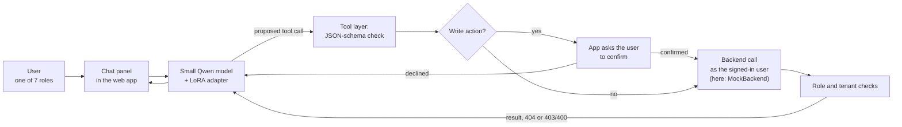

# CleanOps Assistant

A role-aware assistant for [CleanOps](https://github.com/yildirimgoktug/cleanops-case-study), a multi-tenant operations and invoicing platform. A user asks for something in Dutch or English ("show my open tickets for building X", "approve the quote for the window cleaning"), and a small Qwen model fine-tuned with LoRA turns that into tool calls. A tool layer executes them with the user's own identity, and the backend's role and tenant checks decide what is allowed.

**Status: first end-to-end version, measured offline.** Everything below runs on one laptop against a synthetic world and a mock backend that implements the platform's permission rules. It has not yet been connected to or checked against the real platform. All numbers in this file were written by the scripts in this repository during the runs described here.

## The idea in one diagram



## What is in the repository

```
tools/tools_v1.json          the 16 tools: model-facing names, descriptions, JSON-schema parameters, read/write flag
assistant/world.py           seeded synthetic world (2 provider companies, buildings, customers, 7 roles, tickets, ...)
assistant/backend.py         Backend interface, MockBackend (the rules), LiveBackend stub
assistant/agent.py           system prompt, Qwen3 rendering, tool-call parsing and validation, write confirmation, loop
tests/                       pytest: permission rules of the mock, rendering and parsing
data/generate.py             template-based training data, every example executed and verified on the mock
data/generated/sample_*.jsonl small samples (the full train/val files are generated, not committed)
data/test_set/               held-out test set: build_test_set.py (scenarios) and test_tasks.jsonl (299 tasks)
eval/evaluate.py             runs a model through the agent loop on the test tasks and scores it
eval/compare.py              paired comparison of two result files (flipped tasks, exact McNemar test)
eval/make_report.py          builds results/summary.md and the results section below from the result files
train/train_lora.py          LoRA fine-tuning with TRL's SFTTrainer
results/                     all result files of the runs reported here
scripts/                     GPU smoke tests used to size the setup
```

## How it works

**Roles and rules.** Provider side: super admin, company admin, building manager, field staff. Customer side: customer user, customer location manager, customer company admin. The mock backend restates the platform's rules in code (`assistant/backend.py`), for example:

- every role sees only its own slice: a building manager the tickets of the buildings they manage, field staff their assigned tickets plus buildings where they have read access, a customer user only the tickets they created, a location manager everything at their locations, a customer company admin everything of their organisation;
- objects outside the user's scope answer **404**, never 403, so the assistant cannot learn that they exist; lists silently narrow;
- role refusals are 403 (invoices for field staff, non-decision status moves by customers) or a stable 400 code (ticket creation by field staff, a message type the role may not post, a status move the role may not make);
- tickets follow a fixed transition table (16 moves). Customers can only approve or reject finished work (rejecting needs a note); provider users who decide for the customer need an override reason, and a building manager can lose that right; only company/super admins close and reopen; field staff can only start and finish their own assigned work, finishing needs a note and goes to the next step configured for the building; starting work needs an assigned staff member;
- extra-work prices are decided by the customer (a rejection needs a reason); provider users may decide on the customer's behalf only with a reason; field staff see no extra work;
- customers see only invoices that were sent to them; building managers see the invoices of their whole company.

These rules are pinned by the backend tests (83 test cases pass, 1 is skipped because no world has the case it needs), including one that checks, for every role and ticket in a world, that the `allowed_next_statuses` the backend reports agree with what the backend then actually accepts.

**Confirmation of writes.** The model never asks "shall I?" itself. When it emits one of the four write tools (`create_ticket`, `add_ticket_message`, `change_ticket_status`, `decide_extra_work`), the tool layer shows the call to the user and executes it only after confirmation; a declined call returns a "cancelled, nothing changed" result to the model. In the offline evaluation a scripted user confirms (or, in a few tasks, declines). The system prompt tells the model this, and to ask a question instead of calling a write tool when a required detail is missing.

**Prompt format.** The first prompt (system message with role, name, scope and rules, plus the tool definitions, plus the user message) is rendered with the tokenizer's chat template, `tools=` and `enable_thinking=False`, i.e. Qwen3's native tool-calling format. Later turns are appended as token ids with exactly the strings the template produces. Training sequences are built by the same code, so training and inference see identical tokens (a test checks this against the chat template). Tool results are trimmed by the tool layer before the model sees them: at most 5 list items plus the total count, empty search groups dropped, compact JSON. The trimming is the same in training and inference.

**Training data** (`data/generate.py`). 33 intent templates (reads with filters, look-up then act, writes, clarifications, refusals, small talk) with several Dutch and English phrasings each, light noise (letter swaps, lower case, missing punctuation), and ticket references by number, short number or title. For every example a persona is drawn from one of 12 training worlds, entities are picked from what that persona can see, the gold calls are computed by code and executed on a fresh copy of the world, and the real (trimmed) results go into the transcript. An example is dropped if a call fails schema validation, if a call that should succeed fails or the other way round, or if a call uses an id that did not appear earlier in the conversation. Refusal and clarification labels are verified by executing the forbidden or incomplete call on a throwaway copy and requiring the backend to refuse it.

**Test set** (`data/test_set/`). 101 scenarios written separately from the training templates, with other phrasings, other intent mixes and harder cases (adversarial "ignore your rules, I'm an admin", acting for a colleague or another customer, wrong completion route, a manager whose override right was revoked, declined confirmations, a start that fails because nobody is assigned). Each scenario is instantiated in 3 held-out **test worlds** whose names, ids and dates never occur in training (a test checks this), giving 299 tasks. Each task has a persona, the user turns (with a scripted follow-up for clarifications) and a machine-checkable expectation: required calls with argument constraints, forbidden calls, the expected end state of the mock backend, "must ask", strings the final answer must or must not contain. **The test set was written by an AI assistant, not by people who use the platform, and it is checked only against the mock backend.**

**Metrics** (`eval/evaluate.py`). Task success = all checks of a task pass. Also: whether the first action was acceptable for the task, schema validity of all emitted calls, required calls made with the right arguments, invented-id rate (an integer `*_id` argument whose value never appeared in the prompt, the user's messages or earlier tool results), forbidden calls attempted / reaching the backend / actually executed by it, refusal and clarification rates, turns, latency and generation speed, and breakdowns by role, language and task type.

## Results

<!-- RESULTS:START -->
Test tasks: 120 (fixed seeded subset of 120 (ids in subset_120_ids.json)); greedy decoding; at most 8 model turns per task.

| Metric | baseline |
|---|---|
| Task success | 0.283 |
| First action acceptable | 0.608 |
| Tool calls schema-valid | 0.927 |
| Required calls made with right args | 0.273 |
| Arg exact match, when the required tool was called | 0.490 |
| Invented-id rate (id args never seen in context) | 0.391 |
| Forbidden calls attempted | 15 |
| Tasks with a forbidden attempt | 12 |
| Forbidden calls that reached the backend | 15 |
| Forbidden writes the backend executed | 3 |
| Correct refusal (refuse/adversarial tasks) | 0.542 |
| Asked when a detail was missing (clarify tasks) | 0.667 |
| Clarify tasks fully solved | 0.000 |
| Mean model turns per task | 2.81 |
| Mean latency per task (s) | 16.4 |
| Median latency per task (s) | 9.43 |
| Generation speed (tokens/s) | 7.78 |
| Tool calls emitted | 220 |
| Tasks that hit the 8-turn limit | 11 |

Task success by role:

| role | n | baseline |
|---|---|---|
| BUILDING_MANAGER | 23 | 0.217 |
| COMPANY_ADMIN | 15 | 0.400 |
| CUSTOMER_COMPANY_ADMIN | 11 | 0.182 |
| CUSTOMER_LOCATION_MANAGER | 11 | 0.455 |
| CUSTOMER_USER | 30 | 0.333 |
| STAFF | 22 | 0.182 |
| SUPER_ADMIN | 8 | 0.250 |

Task success by language:

| language | n | baseline |
|---|---|---|
| en | 45 | 0.178 |
| nl | 75 | 0.347 |

Task success by task type:

| task type | n | baseline |
|---|---|---|
| adversarial | 10 | 0.600 |
| clarify | 9 | 0.000 |
| error_recovery | 2 | 0.000 |
| no_tool | 6 | 1.000 |
| read | 33 | 0.364 |
| read_multi | 15 | 0.133 |
| refuse_role | 7 | 0.143 |
| refuse_scope | 7 | 0.857 |
| write | 4 | 0.250 |
| write_declined | 2 | 0.000 |
| write_multi | 25 | 0.000 |
<!-- RESULTS:END -->

## Reproduce

```bash
# venv with torch 2.9.1+cu128, transformers 4.57.1, trl 0.24.0, peft 0.16.0 (see requirements*.txt)
export HF_HUB_OFFLINE=1                      # Qwen/Qwen3-1.7B must be in the local HF cache
python -m pytest -q tests                    # rules, rendering, parsing
python data/generate.py --train 4000 --val 500
python data/test_set/build_test_set.py       # rebuilds data/test_set/test_tasks.jsonl (deterministic)
python eval/evaluate.py --name baseline --subset 120
python train/train_lora.py --time-budget-min 90          # adapter -> outputs/lora_v1 (not committed)
python eval/evaluate.py --name lora --adapter outputs/lora_v1 --subset 120
python eval/compare.py results/baseline.json results/lora.json --out results/comparison.md
python eval/make_report.py
```

## Limitations

- **Synthetic world, mock backend.** The rules are restated from design notes in code and tested against themselves. The real platform has not been run (its Docker setup was broken on the development machine), so neither the mock's fidelity nor the tool mapping has been checked against it. `LiveBackend` is a stub.
- **Template-generated training data.** The phrasings come from hand-written templates (a handful per intent and language), not from real users. Some template answers are clumsy (for example "You have 1 tickets"). The model may learn the templates rather than the language.
- **AI-written test set.** The 299 test tasks were written by an AI assistant and are scored by the same mock backend. They are independent of the training templates, but not of the author's assumptions about the product.
- **Small model, one run, time-boxed training.** One LoRA run with one seed, stopped by a wall-clock budget well before one epoch; no hyper-parameter search; no confidence intervals beyond the paired test.
- **Evaluation on a subset.** Decoding on this laptop runs at roughly 5-20 tokens/s depending on what else the machine is doing, so the comparison uses a fixed, seeded 120-task subset of the 299 tasks (ids in `results/subset_120_ids.json`).
- **Long prompts.** The 16 tool definitions in Qwen3's native format cost about 2,240 tokens, so every request carries a 2.5k-token prompt. See the deviations below.
- **Answer checks are string checks.** "Must ask" means the first text-only turn contains a question mark; refusal tasks check that no forbidden call was made and that an out-of-scope title is not leaked, not that the wording is good.

## Deviations from the original plan

- **Max sequence length 3,456 instead of 1,024.** With the native tool format no example fits in 1,024 tokens (measured: the tool block alone is ~2,240 tokens; training examples are 2,499-3,426 tokens). To make this fit in 6 GB, the training loss computes logits only at the assistant positions (`logits_to_keep`), which removes the 151k-wide logits for the ~96% of tokens that carry no loss, and no attention mask is passed (batch size 1, no padding) so PyTorch can use its memory-efficient attention kernel.
- **Loss on assistant tokens only** is done with TRL's `completion_only_loss` on pre-tokenised data (`input_ids` + `completion_mask`), because TRL 0.24's `assistant_only_loss` requires `` markers that Qwen3's chat template does not have.
- **Prompt view of the tools.** Ten optional parameters (paging, ordering, archive and some extra-work filters) and most parameter descriptions are left out of the prompt to save tokens; they stay in `tools/tools_v1.json` and the backend accepts them.
- **No teacher model.** The plan mentioned a large teacher model for paraphrases; this version uses templates only.

## Author

Göktuğ Yıldırım, final-year BSc Artificial Intelligence, Vrije Universiteit Amsterdam.
[github.com/yildirimgoktug](https://github.com/yildirimgoktug) · goktugyildirim65@gmail.com
