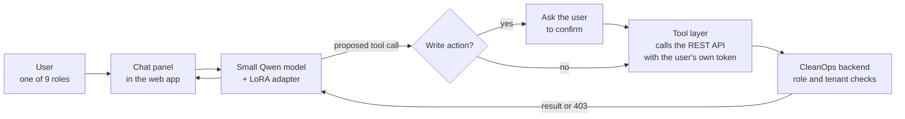

# CleanOps Assistant

A role-aware assistant for [CleanOps](https://github.com/yildirimgoktug/cleanops-case-study), a multi-tenant operations and invoicing platform. A user asks for something in Dutch or English ("show my open tickets for building X", "mark this extra-work request as approved"), and a small Qwen model fine-tuned with LoRA turns that into calls against the platform's own REST API.

**Status: design stage.** Nothing here is trained or measured yet. This file is the plan; results will replace it as they exist.

## The idea in one diagram

## Design decisions

- **The model never holds permissions.** Every tool call goes through the existing API with the signed-in user's token, so the backend's role and tenant checks decide what happens. If a customer asks for something only an admin may do, the API refuses and the assistant says so.
- **Writes need a confirmation.** The assistant may read freely within the user's scope. Anything that changes data is shown to the user first.
- **Small model, trained for this job.** The target is a model that runs on a 6 GB laptop GPU. A large model (Qwen3.6-35B-A3B, running locally) acts as the teacher: it generates candidate dialogues and tool calls, which are kept only if they execute correctly against a seeded development instance.
- **Local by default.** No customer data leaves the machine the platform runs on.

## Plan

1. **Tool schema.** Pick a first set of about 15 API operations (mostly reads, a few writes) and describe them as tools.
2. **Data.** Generate requests per role in Dutch and English with the teacher model, execute the proposed calls against a seeded dev instance, and keep only verified examples. Hold out a test set written by hand.
3. **Training.** LoRA fine-tune of a small Qwen model on the verified examples.
4. **Evaluation.** On the held-out set, per role:
   - task success (the right calls with the right arguments);
   - tool-call validity (parses, matches the schema);
   - permission behaviour (requests outside the user's rights are refused, and none is executed);
   - latency on the target hardware.
   Baselines: the small model without the adapter, and the teacher model without fine-tuning.
5. **Integration.** A chat panel in the web app behind a feature flag.

## What this repository will contain

Training and evaluation code, the tool schema, the synthetic-data pipeline and the results. It will not contain the platform's source code or any customer data; the platform itself is private.

## Author

Göktuğ Yıldırım, final-year BSc Artificial Intelligence, Vrije Universiteit Amsterdam.
[github.com/yildirimgoktug](https://github.com/yildirimgoktug) · goktugyildirim65@gmail.com
